# TraceNest — Application Failure Investigation & AI-Assisted Observability Platform

[](https://fastapi.tiangolo.com)
[](https://nextjs.org)
[](https://www.typescriptlang.org)
[](https://python.org)
[](https://www.postgresql.org)
[](https://github.com)
[](LICENSE)

> **TraceNest** bridges the gap between high-volume, noisy raw error logs and actionable, evidence-grounded root-cause diagnosis. It collects error events and API latency metrics, deterministically normalizes and collapses duplicate crashes into unified incident cards, tracks chronological event timelines, and uses an evidence-grounded AI assistant with prompt injection defenses to diagnose root causes.

---

## Quick Navigation

- 📘 **[Portfolio & Technical Interview Guide](docs/portfolio_demo.md)** — 5-minute presentation script, architecture diagram, 15 deep technical interview Q&As, and security matrix.
- 🚀 **[Production Deployment Guide](docs/deployment_guide.md)** — Containerized topology, Caddy automated TLS reverse proxy, persistent database volumes, and low-cost cloud hosting comparison.
- ⚡ **[Connect Your Application in 5 Minutes](docs/tutorial_5_minutes.md)** — Step-by-step SDK installation and telemetry forwarding.
- 📦 **SDKs**: [Python SDK (`tracenest-sdk`)](packages/python/README.md) | [TypeScript SDK (`@tracenest/sdk`)](packages/typescript/README.md)
- 💡 **Runnable Examples**: [FastAPI Storefront](examples/python-fastapi/) | [Express Service](examples/node-express/)

---

## 1. Problem Statement & Realistic Use Cases

### The Problem
In distributed microservice architectures, when a downstream database or third-party payment gateway fails, on-call engineers face two extremes:
1. **Alert Fatigue**: Hundreds of nearly identical errors flood logging systems. Because raw backtraces contain volatile runtime identifiers (memory addresses `0x7fff...`, timestamps, variable line offsets), traditional logging tools treat each crash as an isolated incident.
2. **AI Hallucination**: Generic LLM troubleshooting prompts pasted into ChatGPT lack deterministic execution evidence, frequently hallucinating irrelevant fixes or exposing confidential tokens embedded in error logs.

### Who TraceNest Is For
- **Backend & Distributed Systems Engineers**: Needing deterministic error grouping that collapses 10,000 spikes into 1 actionable incident.
- **DevOps & Site Reliability Engineers (SREs)**: Requiring least-privilege telemetry ingestion, rate limiting, and automated database disaster recovery.
- **Full-Stack Teams**: Seeking a self-hostable, lightweight incident dashboard with evidence-grounded AI root-cause diagnosis.

---

## 2. Core Architecture & End-to-End Data Flow

TraceNest is built as a hardened **modular monolith** with clean boundary isolation between client SDKs, security middleware, async database persistence, and AI inference:

```mermaid
flowchart LR
    App["Monitored App\n(Python / Node.js)"] -->|1. Capture Error| SDK["TraceNest SDK\n(Client-side Sanitization)"]
    SDK -->|2. POST /api/v1/telemetry\nX-API-Key: tn_ingest_*| Edge["Edge Security\n(Tracing, CORS, Rate Limit)"]
    Edge -->|3. Authenticate Scope| Auth{"Role Guard\n(deps.py)"}
    Auth -->|4. Valid Ingestion Token| Norm["Normalization Engine\n(Strip Volatile Pointers)"]
    Norm -->|5. Hash Frame Checksum| Fingerprint["Fingerprinting Engine\n(Deterministic SHA-256)"]
    Fingerprint -->|6. Atomic Upsert| DB[(PostgreSQL 16 DB\nissue_groups & events)]
    DB -->|7. View Incidents| Dashboard["Next.js 14 Dashboard\n(Timeline & Triage)"]
    Dashboard -->|8. POST /investigate\nX-API-Key: tn_mgmt_*| AI["AI Investigation Engine\n(Prompt Shield + LLM)"]
    AI -->|9. Structured JSON Report| Dashboard
```



---

## 3. Key Technical Innovations

### A. Deterministic Normalization & Fingerprinting
Volatile memory addresses (`0x000001f3a2b4`), epoch timestamps, and variable UUIDs are normalized using compiled regex patterns in [`normalization_service.py`](backend/app/services/normalization_service.py). Exception types and primary stack frames are extracted to compute a deterministic SHA-256 fingerprint:
$$\text{fingerprint} = \text{SHA-256}\left(\text{NormalizedType} + \text{":"} + \text{NormalizedFrames}\right)$$
In PostgreSQL, an atomic upsert increments `occurrence_count` and updates `last_seen` without race conditions or duplicate alert tickets.

### B. Scoped Credentials & Privilege Separation (Phase 8)
TraceNest strictly enforces the **Principle of Least Privilege**:

| Credential Type | Prefix | Permitted Operations | Access Restrictions |
| :--- | :--- | :--- | :--- |
| **Scoped Ingestion Key** | `tn_ingest_...` | • Ingest error & metric telemetry (`POST /api/v1/telemetry`) | ❌ **403 Forbidden** on `/projects/*`<br>❌ **403 Forbidden** on `/issues/*`<br>❌ **403 Forbidden** on `/investigate` |
| **Management Key** | `tn_mgmt_...` | • Full project settings & credential lifecycle<br>• Triage issue status (`unresolved`, `investigating`, `resolved`)<br>• Trigger AI investigations<br>• Telemetry submission (backward compatible) | ✅ Full Administrative Privileges |

- **Zero Plaintext Storage**: Raw credentials are displayed only once upon generation. High-entropy SHA-256 hashes are verified via indexed database lookups.
- **Independent Key Lifecycle**: Teams can provision scoped keys per environment (`prod-checkout`, `staging-worker`), rotate or revoke them without rotating the master management key or logging out of the dashboard.

### C. Evidence-Grounded AI Investigation with 4-Tier Prompt Defense
Untrusted stack traces and error messages can contain malicious user inputs or sensitive secrets. TraceNest protects LLM interactions via 4 defensive perimeters:
1. **Recursive Credential Masking**: Keys like `password`, `token`, `authorization`, and `secret` are sanitized to `[REDACTED]`.
2. **XML Delimiter Isolation**: Untrusted telemetry evidence is strictly encapsulated in labeled `<telemetry_evidence>` boundary tags.
3. **System Role Anchoring**: Explicit system prompts instruct the model to treat all evidence as inert log data and reject embedded instructions.
4. **Pydantic Schema Validation**: Responses are validated against an `InvestigationReport` schema (`root_cause`, `confidence_score: float (0.0-1.0)`, `hypotheses: list[str]`). If the AI provider is offline, TraceNest falls back gracefully without crashing.

### D. Worker-Partitioned Sliding-Window Rate Limiting
To enforce target throughput limits without requiring an external Redis cluster:
$$\text{effective\_limit} = \max\left(1, \left\lfloor \frac{\text{limit}}{\text{WORKERS}} \right\rfloor\right)$$
Each worker tracks timestamps in an in-memory `collections.deque`, achieving O(1) amortized filtering with zero network hops.

---

## 4. Official Developer SDKs

### Python SDK (`tracenest-sdk`)
- **Package**: [`packages/python/`](packages/python/)
- **Installation**: `pip install tracenest-sdk` (or `pip install -e packages/python`)
- **Features**: Synchronous (`TraceNest`) and asynchronous (`AsyncTraceNest`) clients, non-throwing default policy (never crashes monitored applications), automatic backtrace formatting, metadata bounding (32 KB).

```python
from tracenest import TraceNest

client = TraceNest(
    api_key="tn_ingest_your_scoped_key",
    endpoint="http://localhost:8000",
)

try:
    process_order()
except Exception as exc:
    client.capture_exception(
        exc,
        endpoint="/api/v1/orders/checkout",
        http_status=500,
        metadata={"order_id": "ord_102"},
    )
    raise  # Original exception is completely preserved
```

### TypeScript / Node.js SDK (`@tracenest/sdk`)
- **Package**: [`packages/typescript/`](packages/typescript/)
- **Installation**: `npm install @tracenest/sdk`
- **Features**: Full TypeScript types, native `fetch` (Node 18+), Express/Fastify error middleware integration, sensitive key redaction.

```typescript
import { TraceNest } from "@tracenest/sdk";

const tracenest = new TraceNest({
  apiKey: process.env.TRACENEST_API_KEY, // Use tn_ingest_... scoped key
  endpoint: "http://localhost:8000",
});

app.use(async (err, req, res, next) => {
  await tracenest.captureError(err, {
    endpoint: req.originalUrl,
    requestId: req.headers["x-request-id"],
  });
  res.status(500).json({ error: "Internal Server Error" });
});
```

---

## 5. Local Setup from Clean Checkout

### Prerequisites
- **Python 3.12+**
- **Node.js 20+** and **npm**
- **PostgreSQL 16+** (Running locally on port 5432)

---

### Step 1: Clone Repository & Configure Environment Files
```bash
git clone https://github.com/your-username/tracenest.git
cd tracenest

# Configure backend environment
cp backend/.env.example backend/.env

# Configure frontend environment
cp frontend/.env.example frontend/.env.local
```

---

### Step 2: Backend Setup & Database Migrations
```bash
cd backend

# Create and activate Python virtual environment
python -m venv venv

# Windows (PowerShell)
.\venv\Scripts\Activate.ps1
# Linux / macOS
source venv/bin/activate

# Install backend dependencies and local Python SDK
pip install -r requirements-dev.txt
pip install -e ../packages/python

# Run reversible Alembic database migrations
alembic upgrade head

# Start FastAPI development server
uvicorn app.main:app --reload --host 127.0.0.1 --port 8000
```
Backend API will be running at [http://127.0.0.1:8000](http://127.0.0.1:8000) (Interactive Swagger Docs: [http://127.0.0.1:8000/api/v1/docs](http://127.0.0.1:8000/api/v1/docs)).

---

### Step 3: Frontend Setup (Next.js Dashboard)
In a second terminal:
```bash
cd frontend
npm install
npm run dev
```
Open [http://localhost:3000](http://localhost:3000) to view the TraceNest Dashboard.

---

### Step 4: AI Provider Configuration (Optional)
In `backend/.env`:
- **Default (Zero External Dependencies)**: `AI_PROVIDER=mock` — Works out of the box without an API key; returns structured realistic diagnoses.
- **Google Gemini (Recommended)**: Set `AI_PROVIDER=openai_compatible`, `AI_BASE_URL=https://generativelanguage.googleapis.com/v1beta/openai/`, `AI_MODEL=gemini-1.5-flash`, and `AI_API_KEY=your_key`.
- **OpenAI**: Set `AI_PROVIDER=openai_compatible`, `AI_MODEL=gpt-4o-mini`, and `AI_API_KEY=your_key`.

---

### Step 5: Seed Realistic Demo Telemetry
To populate your local dashboard with realistic failure groups (payment timeouts, database deadlocks, cache disconnects):
```bash
cd backend
python -m app.cli.seed_demo
```

---

## 6. Testing & Quality Gates

The repository maintains **100% passing tests** (104 automated tests across 4 test suites) with zero failures:

| Test Suite | Framework | Count | Result | Scope / Coverage |
| :--- | :--- | :---: | :---: | :--- |
| **Backend API & Core** | Pytest (AsyncPG + AnyIO) | **62 tests** | **PASS (100%)** | Health, telemetry, fingerprinting, grouping, AI investigation, scoped credentials, rate limiting, security middleware |
| **Python SDK Unit Suite** | Pytest | **10 tests** | **PASS (100%)** | Initialization, exception serialization, metadata redaction, rate limit handling, async client, non-crash error policy |
| **TypeScript SDK Suite** | Vitest | **8 tests** | **PASS (100%)** | Environment detection, fetch client mocking, timeout handling, metadata masking, non-throwing policy |
| **Frontend Component Suite** | Vitest + RTL | **24 tests** | **PASS (100%)** | Dashboard metrics, issue tables, badges, stack trace viewer, AI investigation trigger & display |
| **Next.js Production Build** | Next.js Standalone Compiler | **5/5 routes** | **SUCCESS** | Standalone bundle generation, dynamic routing (`/issues/[id]`), zero lint or type errors |
| **Disaster Recovery Audit** | Python + PostgreSQL 17 | **100% Parity** | **PASS** | Automated `pg_dump` backup, disposable DB restore, table row-count match |
| **Live End-to-End Suite** | Python + AsyncClient | **13 Checks** | **PASS** | Ingestion permissions, 403 enforcement, duplicate grouping, chronological event timeline |

### Execute Test Suites Locally
```bash
# Backend test suite (62 tests)
cd backend && powershell -Command "$env:CURL_CA_BUNDLE = $null; .\venv\Scripts\python.exe -m pytest -v"

# Python SDK unit tests (10 tests)
powershell -Command "$env:CURL_CA_BUNDLE = $null; .\backend\venv\Scripts\python.exe -m pytest packages/python/tests -v"

# TypeScript SDK unit tests (8 tests)
npx --prefix frontend vitest run packages/typescript/tests/client.test.ts

# Frontend component tests (24 tests)
cd frontend && npm test

# Next.js standalone production build
cd frontend && npm run build

# Disaster recovery backup & restore verification
powershell -Command "$env:CURL_CA_BUNDLE = $null; .\backend\venv\Scripts\python.exe scripts\verify_backup_recovery.py"

# End-to-end live system audit (13 checks)
powershell -Command "$env:CURL_CA_BUNDLE = $null; .\backend\venv\Scripts\python.exe scripts\verify_live_system.py"
```

---

## 7. Troubleshooting Local Setup

| Issue | Root Cause | Solution |
| :--- | :--- | :--- |
| **`ConnectionRefusedError` on Port 5432** | PostgreSQL service is not started | Start PostgreSQL via Windows Services (`services.msc`) or `sudo systemctl start postgresql`. Verify password in `backend/.env`. |
| **`403 Forbidden` on `/projects` or `/issues`** | Using a scoped ingestion key (`tn_ingest_...`) | Ingestion keys can only post telemetry. Use your management key (`tn_mgmt_...`) for dashboard and administrative operations. |
| **PowerShell `CURL_CA_BUNDLE` or quote syntax errors** | Windows environment variable conflict | Run with `$env:CURL_CA_BUNDLE = $null` prefixed before Python commands as shown above. |
| **CORS blocked from `http://localhost:3000`** | Origin not in backend configuration | Confirm `BACKEND_CORS_ORIGINS=["http://localhost:3000","http://127.0.0.1:3000"]` in `backend/.env`. |
| **Next.js `EINVAL: readlink` during rebuild** | Windows file lock on previous `.next` directory | Run `Remove-Item -Recurse -Force .next` before executing `npm run build`. |

---

## 8. Automated CI/CD Pipeline

The repository includes a GitHub Actions workflow ([`.github/workflows/ci.yml`](.github/workflows/ci.yml)) configured with 4 parallel quality gates:
1. **`python-sdk-ci`**: Tests `tracenest-sdk` on Python 3.12, verifies example syntax.
2. **`typescript-sdk-ci`**: Compiles `@tracenest/sdk` with `tsc`, runs 8 Vitest tests, verifies Node.js example.
3. **`backend-ci`**: Boots a dedicated PostgreSQL 16 service container, runs Alembic migrations, and executes all 62 backend tests with coverage.
4. **`frontend-ci`**: Executes 24 Vitest frontend tests and verifies the Next.js production build.

---

## 9. API Reference Summary

### Authentication & Project Administration
- `POST /api/v1/projects`: Register a project and provision initial management (`tn_mgmt_...`) and scoped ingestion (`tn_ingest_...`) keys.
- `GET /api/v1/projects/me`: Retrieve authenticated project details (Requires `tn_mgmt_...`).
- `POST /api/v1/projects/rotate-key`: Atomically invalidate current management key and issue new raw key.

### Ingestion Key Lifecycle (Phase 8)
- `POST /api/v1/projects/ingestion-keys`: Provision a named ingestion key (e.g. for a staging microservice).
- `GET /api/v1/projects/ingestion-keys`: List active keys safely (returns `key_prefix` and metadata; raw secret never displayed).
- `DELETE /api/v1/projects/ingestion-keys/{key_id}`: Revoke a specific ingestion key immediately.
- `POST /api/v1/projects/ingestion-keys/{key_id}/rotate`: Atomically rotate an ingestion key.

### Telemetry Ingestion
- `POST /api/v1/telemetry`: Ingest error/metric telemetry event (accepts `tn_ingest_...`, `tn_mgmt_...`, or legacy `tn_live_...`).

### Incident & Issue Management
- `GET /api/v1/issues`: List grouped issues with filtering (`status`, `severity`, `search`) and pagination (`page`, `per_page`).
- `GET /api/v1/issues/{issue_id}`: Get issue details and recent event timeline.
- `PATCH /api/v1/issues/{issue_id}`: Update triage status (`unresolved`, `investigating`, `resolved`, `ignored`).

### AI Incident Investigation
- `POST /api/v1/issues/{issue_id}/investigate`: Run evidence-grounded AI root-cause diagnosis using incident telemetry and stack traces.

### Service Health Probes
- `GET /health`: Minimal root liveness probe (`{"status":"ok","service":"tracenest-backend"}`).
- `GET /api/v1/health`: Detailed readiness probe verifying active PostgreSQL database connectivity (`database_connected: true`).

---

## 10. License

This project is licensed under the [MIT License](LICENSE).
